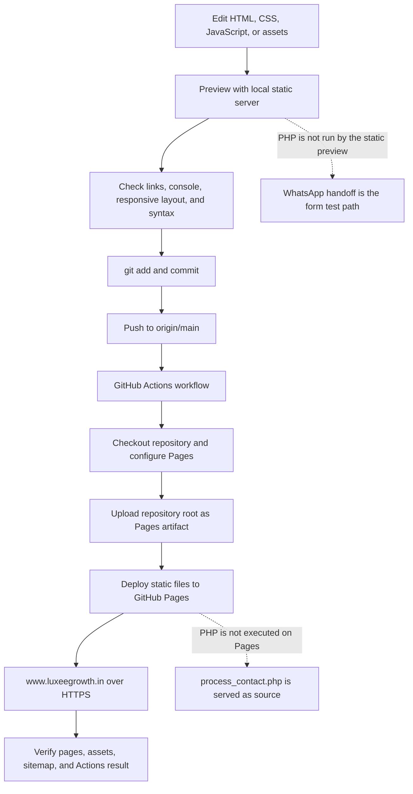

# LUXEE GROWTH Website Handbook

Operational documentation for the LUXEE GROWTH website. This guide describes the repository as inspected on 2026-10-20. It distinguishes verified behavior from recommendations; it does not claim search rankings, form delivery, or accessibility results that have not been measured.

## 1. Project Overview

LUXEE GROWTH is a small, hand-authored, multi-page website for a digital studio serving Hyderabad. It is built from plain HTML, CSS, and browser JavaScript. GitHub Pages publishes the files from the `main` branch to [www.luxeegrowth.in](https://www.luxeegrowth.in/).

There is no framework, package manager, database, CMS, build step, or automated test suite in the repository. The static pages can be edited directly. A PHP contact handler exists in the source tree, but GitHub Pages does not execute PHP; the production form's usable flow is the browser-generated WhatsApp handoff described under [Forms and Integrations](#11-forms-and-integrations).

## 2. Features and Capabilities

- Home, services, and contact pages with shared navigation and footer.
- Six service descriptions: web design, local search / Google Business Profile, 360-degree photography and virtual tours, NFC cards, digital marketing and content, and SEO.
- Responsive layouts with mobile navigation, reduced-motion support, reveal effects, scroll progress, and desktop pointer effects.
- Contact details through telephone, email, Instagram, and WhatsApp links.
- An enquiry form with browser-side validation, progress feedback, service preselection, and a prepared WhatsApp message.
- Page-specific titles, descriptions, canonical URLs, Open Graph tags, a home-page JSON-LD business description, `robots.txt`, and `sitemap.xml`.
- GitHub Actions deployment to GitHub Pages when changes are pushed to `main`.

## 3. Technology Stack

| Area | Implementation | Notes |
| --- | --- | --- |
| Markup | HTML5 | Three standalone documents; no client-side router. |
| Styling | `styles.css` | One global stylesheet with CSS variables and responsive breakpoints. |
| Browser behavior | `scripts.js` | Vanilla JavaScript; loaded with `defer` on all three pages. |
| Images | PNG, JPEG, SVG | Stored under `assets/` or at the repository root. |
| Icons and fonts | Font Awesome CDN; Google Fonts | External requests to Cloudflare's cdnjs, Google Fonts, and Google Fonts Static. |
| Hosting | GitHub Pages | Static files from the repository root; no PHP runtime. |
| Deployment | GitHub Actions | A single workflow triggers on pushes to `main` and manual dispatch. |
| Server-side code | PHP source file present | `process_contact.php` is not executed on Pages; see the security notes. |

There are no `package.json`, lockfiles, TypeScript sources, environment files, install scripts, bundler, or local dependencies to install.

## 4. Architecture and Workflow Diagram



**Page load example:** `index.html` links `styles.css`, defers `scripts.js`, and refers to the logo and illustrations by relative paths. `scripts.js` waits for `DOMContentLoaded`, then initializes only the controls present on that page. Shared navigation and footer markup are repeated in each HTML file; they are not generated components.

## 5. Repository Directory Structure

```text
.
├── .github/
│   └── workflows/
│       └── static.yaml         # Pages deployment workflow
├── assets/
│   ├── illustrations/          # Service and studio SVG illustrations
│   ├── partners/               # Partner logos
│   └── luxee-logo.png          # Page logo, social image, and CSS mask source
├── apple-touch-icon.png        # 180 x 180 mobile home-screen icon
├── contact.html                # Contact details and enquiry form
├── favicon-16x16.png           # Small browser/search icon
├── favicon-32x32.png           # Standard browser icon
├── favicon-48x48.png           # Large crawler/browser icon
├── favicon.ico                 # ICO with multiple raster sizes
├── favicon.svg                 # Scalable gold growth-mark favicon
├── index.html                  # Home page
├── luxeegrowthlogo.jpeg        # Root-level JPEG; no source references found
├── process_contact.php         # PHP handler source; not executed by Pages
├── robots.txt                  # Allows crawling and points at sitemap
├── scripts.js                  # Shared navigation, motion, scroll, and form behavior
├── services.html               # Six service descriptions and enquiry links
├── sitemap.xml                 # The three canonical public pages
├── styles.css                  # Global theme, layout, responsive rules, and animation
├── .gitignore                  # Excludes contact-submission log filenames
├── .htaccess                   # Apache rule denying CSV and log files; Pages ignores it
└── README.md                   # This operational manual
```

### Asset inventory

`assets/illustrations/` contains `content-creation.svg`, `local-search.svg`, `nfc-cards.svg`, `seo-analytics.svg`, `studio-path.svg`, `virtual-tour.svg`, and `web-design.svg`, plus `journal-building.svg`, `journal-mobile.svg`, `journal-space.svg`, and `journal-work.svg`. The `journal-*` illustrations were not referenced by the inspected HTML, CSS, or JavaScript. `assets/partners/` contains `anutex.png`, `apollo-hospitals.svg`, `dtdc.png`, and `jawed-habib.png`; the home page displays them as external links.

The root `luxeegrowthlogo.jpeg` was not referenced by the inspected source. Keep it until you confirm it is no longer needed elsewhere; the active page logo is `assets/luxee-logo.png` (902 x 679 RGBA PNG). The favicon is a separate gold growth-mark set in the repository root. No source maps, generated build output, or automated asset pipeline were found.

### What is safe to edit?

Edit the HTML pages for content and metadata, `styles.css` for presentation, `scripts.js` for interactions, and files under `assets/` for images. Keep filenames and case consistent because GitHub Pages paths are case-sensitive. Update every reference when renaming or moving an asset. Edit workflow files only when you intend to change deployment behavior. Do not commit visitor submission logs or real enquiry data.

## 6. Installation and Prerequisites

Required for editing and basic preview:

- Git.
- Python 3 for the optional local static preview server, or another local static-file server.
- A modern browser and an editor such as VS Code.

Optional tools used for source checks:

- Node.js, to run `node --check scripts.js`.
- PHP CLI, to run `php -l process_contact.php`. This checks syntax only; it does not make the handler work on GitHub Pages.
- GitHub CLI (`gh`), if you want to inspect Actions from the terminal. Web access to the repository's Actions tab is an alternative.

Clone and enter the repository:

```bash
git clone https://github.com/kondabattulabalachandra-creator/LUXEE-GROWTH.git
cd LUXEE-GROWTH
```

Expected result: a checkout containing the files in the tree above. No dependency-install command is required. There is no package manifest or supported `npm install` step.

## 7. Local Development

From the repository root, start a local static server:

```bash
python3 -m http.server 8000 --bind 127.0.0.1
```

Open `http://127.0.0.1:8000/`, then test `/services.html` and `/contact.html`. The server serves files but does not interpret PHP. Stop it with `Ctrl+C` in the terminal where it is running.

If port 8000 is already in use, choose another port, for example `8001`, and open the matching URL. To inspect a listener before stopping anything:

```bash
lsof -nP -iTCP:8000 -sTCP:LISTEN
```

Stop only a process you have identified and started for this preview, using `kill <PID>` with its displayed process ID. Do not kill an unknown process.

There is no build or preview-after-build step: the server serves the source files directly. A static preview is not a production-equivalent test for PHP, email delivery, external integrations, or GitHub Actions.

## 8. Page-by-Page Documentation

| Page | URL | Purpose and main content | Important dependencies and links |
| --- | --- | --- | --- |
| Home | `/` (served from `index.html`) | Hero, studio introduction, service marquee, featured web/local-search/content cards, partner logos, and contact CTA. The hero links into service anchors. | `styles.css`, `scripts.js`, logo, studio/web/local-search/content illustrations, and partner marks. Links to `services.html` and `contact.html`. |
| Services | `/services.html` | Service hero, six detailed service sections, a three-step process, and contact CTA. | `styles.css`, `scripts.js`, logo and service illustrations. The sections use IDs `local-search`, `virtual-tours`, `nfc-cards`, `content`, `web-design`, and `search`. Enquiry links preselect a service on `contact.html`. |
| Contact | `/contact.html` | Contact methods, WhatsApp link, validated project enquiry form, and service picker. | `styles.css`, `scripts.js`, logo, Font Awesome icons, WhatsApp, telephone, email, and Instagram links. Form behavior is detailed below. |

Navigation, logo links, footer links, and the mobile menu are written separately into each page. When changing a shared navigation or footer item, update all three pages and verify the current-page `aria-current` attribute remains correct.

### Editing a page

1. Edit the relevant text or section in that page's HTML.
2. Preserve unique IDs used by navigation and enquiry links.
3. If adding a public page, add its metadata and shared header/footer, link it from navigation where appropriate, and add its canonical URL to `sitemap.xml`.
4. Preview all three pages locally at desktop and mobile widths; inspect browser devtools for missing files or JavaScript errors.
5. Commit and push to `main` only after checking the diff.

## 9. Components and Asset Management

There is no component framework. Repeated UI is implemented as repeated HTML: `.navbar`, `.nav-menu`, `.site-footer`, and `.back-to-top` appear across the pages. Shared behavior lives in `scripts.js`, and shared presentation lives in `styles.css`.

### Logo

The active page logo is `assets/luxee-logo.png`; it is used in page headers, footers, social-preview metadata, JSON-LD, and CSS masks. Preserve its aspect ratio. If replacing it, keep the filename and dimensions where possible. If the filename changes, update the `` references in all HTML pages, social metadata, JSON-LD in `index.html`, and the `mask` / `-webkit-mask` URLs in `styles.css`.

The favicon is separate from the page logo. All three pages reference `/favicon.svg`, `/favicon-16x16.png`, `/favicon-32x32.png`, `/favicon-48x48.png`, `/favicon.ico`, and `/apple-touch-icon.png`. The SVG is the scalable gold growth mark; PNGs cover 16, 32, and 48 px sizes; the ICO contains multiple raster variants; and the Apple touch icon is 180 x 180. Keep the files square, high contrast, and at stable root URLs. When changing the artwork, regenerate all raster/ICO variants from the same source so they remain consistent. The current `robots.txt` allows crawling. Google Search recommends a square icon at least 48 x 48, but display and indexing are controlled by the search engine and are not guaranteed.

### Images

- Put site-wide/service illustrations in `assets/illustrations/`; partner marks belong in `assets/partners/`.
- Prefer compressed SVG for simple vector artwork and optimized PNG/JPEG/WebP for photographs or raster marks. Do not change an extension unless the file format is actually converted.
- Give meaningful images useful `alt` text; decorative images should use empty `alt=""` when appropriate. Preserve or update intrinsic `width` and `height` attributes to reduce layout shifts.
- Keep below-the-fold images `loading="lazy"`; do not lazy-load an above-the-fold hero image that is marked `fetchpriority="high"`.
- Use relative paths like `assets/illustrations/web-design.svg` for page content. Root-relative favicon paths such as `/favicon.svg` assume the site's domain root.
- Check for existing references before deleting an asset. The `journal-*` files and root JPEG were not referenced during this audit.

## 10. Styling and Design System

`styles.css` defines a dark black/ivory/gold palette, spacing and motion rules, shared containers, navigation, buttons, hero areas, service layouts, cards, contact form, footer, and responsive behavior. The main color and font tokens are at the top of the file: `--black`, `--ivory`, `--gold`, `--serif`, `--sans`, and `--ease`.

Fonts are Manrope and Playfair Display loaded from Google Fonts. Icon glyphs use Font Awesome 6.4.0 from cdnjs. If a CDN is blocked, text and layout should remain, but custom font faces or icons may be missing. These dependencies send requests to third-party providers; no local copies or privacy/consent manager were found.

Responsive rules are present at 1100, 980, 960, 680, 520, and 480 pixels, with repeated breakpoints for specific sections. The stylesheet also honors `prefers-reduced-motion`. When adjusting a component, search all selectors and media-query overrides for that component; a later override can supersede an earlier rule.

Examples:

- Change global colors or fonts in `:root` at the top of `styles.css`.
- Adjust the mobile menu or footer by editing its shared selectors and the relevant media-query blocks.
- Change a button's label in HTML; change the visual treatment through `.button` selectors.
- Motion is coordinated between CSS classes in `styles.css` and behavior in `scripts.js`. Preserve reduced-motion handling when adding animations.

## 11. Forms and Integrations

The contact form is in `contact.html` (`#contactForm`); its behavior is in `scripts.js`. It collects name, email, phone, a selected service, and a message. HTML constraints and JavaScript provide browser-side validation, per-field state, progress feedback, character count, URL-driven service preselection, and an accessible status message.

On valid submission, JavaScript builds an encoded WhatsApp message and opens `wa.me` in a new tab. The visitor must press **Send** in WhatsApp. If the popup is blocked, the page displays a fallback link. The script also sends a background `fetch` to `process_contact.php`, but ignores fetch failures and does not treat its response as confirmation.

### Confirmed production limitation

GitHub Pages is static hosting. In the inspected production deployment, `process_contact.php` responds with `application/x-httpd-php`, and its response body contains the PHP source marker. It is **not being executed**. Therefore:

- Do not rely on this endpoint for production email, validation, or storage.
- `.htaccess` is an Apache configuration file and does not protect files on GitHub Pages.
- The Actions workflow uploads the repository root, so files in the repository are part of the published artifact unless the workflow is changed.
- A PHP-capable server could execute the handler, but mail delivery also depends on server mail configuration. No such runtime or mail service was verified here.

The handler source validates fields, attempts `mail()`, and writes a CSV-formatted backup to `contact_submissions.php` if it is run on a PHP host. `.gitignore` excludes `contact_submissions.php` and `contact_submissions.csv`; do not commit enquiry records. Do not run this endpoint with real personal data on an untrusted or public test server.

**Recommended priority:** remove the PHP source from the Pages artifact or move the form handling to a trusted serverless/PHP service with server-side validation, spam/rate controls, secure data retention, and monitored delivery. Do not expose logs or hardcode credentials. Until then, describe WhatsApp as the actual submission path and test that path manually.

Other external links include `tel:`, `mailto:`, WhatsApp, Instagram, and partner websites. Partner links open new tabs with `rel="noopener noreferrer"`.

## 12. SEO and Performance

Current source includes unique titles and meta descriptions, canonical URLs using `https://www.luxeegrowth.in`, Open Graph fields, a Twitter summary card, SVG/PNG/ICO favicons and an Apple touch icon, `robots.txt`, a three-page sitemap, and `ProfessionalService` JSON-LD on the home page. Keep the page title, description, canonical, Open Graph title/description/URL, and visible page content aligned when editing. Do not add fake reviews, locations, awards, or ranking promises to structured data.

For a new page, add one self-canonical URL and its sitemap entry; make sure the page is reachable through a descriptive internal link. After deployment, verify the public HTML and submit the sitemap in Google Search Console if the site owner has access. No Search Console ownership, analytics, or indexation status was verified during this audit. A sitemap helps discovery but does not guarantee indexing or rank.

Performance choices found in source include lazy loading on several below-the-fold images, image dimensions on many major images, deferred JavaScript, and reduced-motion support. No Lighthouse, Core Web Vitals, accessibility, or link-crawl report was run; treat those as unmeasured. External fonts and icons add third-party requests.

## 13. Git and GitHub Workflow

The current branch is `main`; the configured remote is `origin` pointing to the public GitHub repository `kondabattulabalachandra-creator/LUXEE-GROWTH`. Check your local state before editing or staging:

```bash
git status --short
git branch --show-current
git remote -v
git diff
git diff --cached
```

Typical workflow:

```bash
git add README.md
git diff --cached --check
git diff --cached
git commit -m "Document website operations"
git push origin main
```

Replace `README.md` with the paths you intend to include for other tasks. Review staged changes before committing; do not use `git add .` when unrelated or sensitive files may be present.

These actions are different:

| Action | Meaning |
| --- | --- |
| Save | Changes a file in the local working tree; nobody else receives it. |
| Stage | Selects changes for the next commit; it does not publish them. |
| Commit | Records staged changes in local Git history. |
| Push | Sends commits to GitHub. Pushing to `main` triggers the Pages workflow. |
| Deploy | The Actions workflow publishes the pushed repository snapshot to GitHub Pages. |

Useful inspection commands:

```bash
git status --short
git log -5 --oneline
git diff --stat
git diff --check
git branch --show-current
git remote -v
```

If a push is rejected because the remote advanced, fetch and inspect before integrating:

```bash
git fetch origin
git log --oneline --graph --decorate --all -12
```

Then use the team's normal merge/rebase approach. Do not force-push `main` to resolve a rejection.

## 14. Build, Testing, and Deployment

### Build and test status

There is no build command, test runner, formatter, or CI test job. Pages publishes source files directly. Available lightweight checks are:

```bash
node --check scripts.js
php -l process_contact.php
git diff --check
```

`node --check` parses JavaScript without executing it. `php -l` checks PHP syntax only and is not a test of GitHub Pages behavior. If PHP CLI is not installed, skip that check; do not install a runtime just to deploy the static site. Also open each page locally and verify navigation, images, mobile menu, contact validation, and WhatsApp handoff.

The sitemap can be parsed with Python's standard library:

```bash
python3 -c 'import xml.etree.ElementTree as ET; ET.parse("sitemap.xml"); print("sitemap.xml parses")'
```

### Deployment behavior

GitHub Pages is configured through the repository's Pages settings to publish from the `.github/workflows/static.yaml` workflow, source branch `main`, repository root. It triggers on pushes to `main` and manual dispatch. No tests or build/transformation run before upload.

The workflow checks out the repository, configures Pages, uploads `.` as the artifact, and deploys it. The `.htaccess` file is not an active Pages configuration. The PHP file is uploaded like any other file.

After pushing, check **GitHub repository → Actions → Deploy static content to Pages**. Or, with authenticated GitHub CLI:

```bash
gh run list --limit 5
gh run view <RUN_ID>
gh run view <RUN_ID> --log-failed
```

Replace `<RUN_ID>` with the numeric run ID shown by `gh run list`. A successful run should show conclusion `success`; a failed run should be investigated in its step logs. `gh` may require `gh auth login`; use the GitHub web UI if you do not have CLI access.

Verify the published site after a successful deployment:

```bash
curl -sSI https://www.luxeegrowth.in/
curl -sSI https://www.luxeegrowth.in/services.html
curl -sSI https://www.luxeegrowth.in/contact.html
curl -sSI https://www.luxeegrowth.in/assets/luxee-logo.png
curl -sSI https://www.luxeegrowth.in/robots.txt
curl -sSI https://www.luxeegrowth.in/sitemap.xml
```

Expect HTTP 200 responses for these paths. To inspect deployed metadata without downloading the full page to a file:

```bash
curl -fsSL https://www.luxeegrowth.in/ | grep -iE '<title>|rel="icon"|rel="canonical"'
```

If a page is stale immediately after a successful workflow, wait for CDN propagation, request it again, and use a private window or hard refresh to rule out browser cache. Do not diagnose a deployment solely from a cached favicon.

## 15. Custom Domain and Hosting

The repository's GitHub Pages API settings report:

- Published URL: `https://www.luxeegrowth.in/`.
- Custom domain: `www.luxeegrowth.in`.
- Source: GitHub Actions workflow, source branch `main`, repository root.
- HTTPS enforcement: enabled; certificate state was reported as approved during this audit.

There is no tracked `CNAME` file. DNS records are managed outside this repository; the exact DNS provider and record configuration were not inspected. Do not copy guessed DNS values from this README. Verify DNS with the domain provider and GitHub Pages settings. Optional diagnostic commands, if `dig` is installed:

```bash
dig +short CNAME www.luxeegrowth.in
dig +short A www.luxeegrowth.in
curl -sSI https://www.luxeegrowth.in/
```

The bare/apex domain's redirect behavior was not verified. Canonical URLs in the site use the `www` hostname; keep that convention consistent unless the Pages custom domain is intentionally changed.

## 16. Security and Environment Configuration

No `.env` files, API keys, passwords, private keys, or application credentials were found in the inspected tracked source. The workflow uses GitHub's built-in `GITHUB_TOKEN` permissions for Pages and declares no custom application secrets. This is a source inspection, not a credential scanner or full security audit.

Important limitations and risks:

1. **Confirmed:** the Pages host serves `process_contact.php` as source and does not execute it. The endpoint source is publicly retrievable. No secret was found in the inspected source, but the implementation and hardcoded contact destination are exposed.
2. **Confirmed:** `.htaccess` is not honored by GitHub Pages. Do not treat it as a security boundary on the current host.
3. **Confirmed:** browser validation can be bypassed. Any future server endpoint must validate inputs on the server and use spam/rate controls.
4. **Potential:** a PHP-capable host that runs the current logger would store personal enquiry data. Establish access controls, retention, backup, and deletion procedures before enabling it.
5. **Potential:** email delivery via PHP `mail()` depends on host configuration and sender-domain reputation. No delivery provider or SPF/DKIM setup was verified.
6. **Privacy:** Google Fonts and Font Awesome are fetched from third parties. No analytics, cookie banner, consent manager, or privacy policy was found in this repository.

No environment variables are required by the static site. If a future backend requires secrets, store them in the hosting provider's secret manager, never in HTML, JavaScript, Git, or this README.

## 17. Troubleshooting Guide

| Symptom | Likely cause | Investigate | Safe fix and verification |
| --- | --- | --- | --- |
| Blank or incomplete page | Wrong URL, malformed HTML, or missing assets | Open browser devtools; check `curl -sSI https://www.luxeegrowth.in/` and the Actions run. | Use `/` or a tracked `.html` path; fix the reported source; reload and verify page and asset responses are 200. |
| CSS missing | Broken stylesheet path, case mismatch, or failed deployment | `curl -sSI https://www.luxeegrowth.in/styles.css`; inspect the browser Network tab. | Keep `styles.css` at repository root or update all `<link>` paths; confirm it returns 200 and redeploy. |
| Logo or illustration missing | Incorrect path/capitalization, file not committed, or stale deploy | `find assets -type f`; `curl -sSI https://www.luxeegrowth.in/assets/luxee-logo.png`. | Correct the exact path and commit the asset; confirm a 200 response and inspect its rendered dimensions. |
| Styles or assets break after moving a page | Relative URLs resolve from the page's directory | Inspect `<link>`, `<script>`, ``, and CSS `url(...)` paths. | Update all paths; root-relative favicon paths are domain-root paths. Retest from every page. |
| Menu or animation fails | JavaScript syntax/runtime error, missing element, or reduced-motion setting | Run `node --check scripts.js`; inspect browser console. | Fix the exact error; preserve null checks and reduced-motion behavior; retest desktop and mobile. |
| Contact form doesn't open WhatsApp | Invalid fields, popup blocked, browser/device lacks WhatsApp handler, or JavaScript error | Use devtools Console; submit valid test data; look for the fallback link. | Correct validation or permit the popup; verify the prepared message opens and remember that the visitor presses Send. Do not treat it as an automatic send. |
| No email is received from a form | GitHub Pages doesn't run PHP; a PHP host may lack configured `mail()` | `curl -sSI https://www.luxeegrowth.in/process_contact.php`; current Pages returns PHP source rather than executing it. | Use the WhatsApp handoff or deploy a secure backend. Verify receipt only with a controlled test address after backend setup. |
| Form details are not recorded | PHP handler isn't executed on Pages; logger is only written by PHP runtime | Check the hosting runtime and workflow artifact contents. | Do not rely on the PHP logger on Pages. Choose a backend and secure data store before claiming persistence. |
| `node --check` reports a syntax error | Invalid JavaScript syntax | Run `node --check scripts.js` and read the reported line/context. | Correct the syntax, rerun the same check, then manually test all pages that load the shared script. |
| `php -l` is unavailable | PHP CLI is not installed | Run `php --version`. | PHP is optional for the static site. Skip lint or use a trusted PHP-capable environment; linting still doesn't enable PHP on Pages. |
| Git push rejected | Remote contains commits not present locally, or authentication/branch issue | `git status --short`; `git fetch origin`; `git log --oneline --graph --decorate --all -12`. | Integrate remote changes intentionally; authenticate with GitHub; avoid force-pushing `main`. Verify `git status` and push again. |
| Pages workflow failed | Workflow permissions, Pages configuration, or artifact/deploy step failed | Check **Actions** run details or `gh run view <RUN_ID> --log-failed`. | Fix the failed step's cause, push a new commit, and verify a later run succeeds. There is no build/test command to repair. |
| Pages deployment does not start | Workflow file is missing/invalid or the push did not target `main` | Inspect `.github/workflows/static.yaml` and the Actions tab. | Push to `main` or start the workflow manually from Actions; fix any workflow syntax or repository Pages configuration errors. |
| Live page is stale | Workflow still running or CDN/browser cache | Check Actions status and use `curl -fsSL` against the live URL. | Wait for successful deployment and cache propagation; hard-refresh or use a private window. |
| Custom domain/HTTPS error | DNS or Pages domain settings mismatch, or certificate provisioning delay | Inspect Pages settings; use `dig` if available and `curl -sSI https://www.luxeegrowth.in/`. | Correct DNS at the domain provider to match current GitHub Pages guidance; do not guess record values. Confirm Pages reports HTTPS enabled. |
| Layout overflows on mobile | Breakpoint override, long text, or fixed width | Use browser responsive mode at narrow widths; inspect computed styles and the relevant `@media` blocks. | Fix the responsible selector in `styles.css`; retest at approximately 480, 680, 960, and desktop widths. |
| External icon/font missing | CDN blocked, offline, or provider URL changed | Inspect Network panel for cdnjs/Google Fonts failures. | Check the external URL and network policy. If reliability/privacy requires, plan a deliberate local asset strategy; no local package pipeline currently exists. |

## 18. Backup, Rollback, and Recovery

Git history is the primary source backup. Before a large change, inspect `git status` and commit a known-good state. For an isolated experiment, create a branch:

```bash
git switch -c docs-or-design-experiment
```

To safely undo a pushed commit, create a new inverse commit rather than rewriting shared history:

```bash
git log -5 --oneline
git revert <COMMIT_SHA>
git push origin main
```

Replace `<COMMIT_SHA>` with the unwanted commit hash after reviewing it. The push triggers a new Pages deployment. Do not use `git reset --hard` or force-push as routine recovery; those can discard work or shared history.

If GitHub Pages is unavailable, the tracked HTML/CSS/JS/assets can be served by another static host. Reconfigure the domain and HTTPS at that host before switching DNS. The PHP endpoint requires a separate compatible runtime and must not be assumed to migrate with static files.

## 19. Maintenance Checklist

- [ ] Keep contact destinations and visible contact details consistent across pages and JSON-LD.
- [ ] Check navigation and all service anchor IDs after page edits.
- [ ] Keep titles, descriptions, canonicals, social metadata, and sitemap URLs aligned.
- [ ] Add meaningful alt text and dimensions for new images; optimize large assets.
- [ ] Test all three pages at desktop and mobile widths; check keyboard navigation and reduced-motion behavior.
- [ ] Run `node --check scripts.js`, PHP lint if applicable, sitemap XML parse, and `git diff --check`.
- [ ] Review the staged diff before every commit; do not commit enquiry logs or secrets.
- [ ] Verify GitHub Actions and live HTTP responses after pushes to `main`.
- [ ] Review the remaining Pages workflow and the publicly served PHP source as high-priority technical debt.
- [ ] Periodically check external font/icon availability, partner links, accessibility, and real-user performance metrics.

## 20. Known Issues and Technical Debt

Confirmed by source/configuration or live checks:

- GitHub Pages does not execute the PHP contact handler; the live endpoint returns its source. The WhatsApp handoff remains the user-visible delivery workflow.
- The deployment workflow has no automated build, test, or link-check stage.
- `.htaccess` is not effective on GitHub Pages.
- No tests, build, formatter, dependency manifest, link checker, or performance/accessibility CI is configured.
- `luxeegrowthlogo.jpeg` and four `journal-*` SVGs appear unreferenced by inspected site code.
- No Search Console, analytics, privacy/consent configuration, or verified PHP mail provider was found.

Recommendations in priority order:

1. Remove PHP source from the public Pages artifact or move form processing to a secure supported backend; clearly test and monitor the chosen delivery path.
2. Add automated HTML/link/accessibility checks if the project grows; keep deployment static unless a backend is intentionally selected.
3. Set up and verify Google Search Console, then monitor indexing and submit the sitemap. Create/maintain accurate business-profile information and earn genuine local references; do not buy links or publish fabricated reviews.
4. Measure mobile performance and accessibility before choosing further optimizations.

No ranking position, Search Console indexing state, email delivery, spam resistance, or formal accessibility/performance score was established by this repository audit.

## 21. Future Improvements

- Secure form delivery with server-side validation, rate limiting/spam controls, secure storage/retention, and delivery monitoring.
- Consolidate duplicate Pages workflow definitions and add a lightweight validation job.
- Add a privacy policy and explain enquiry-data handling before enabling persistent form storage.
- Add Search Console ownership and an ongoing process for search queries, page indexing, and local business listing consistency.
- Run accessibility and Core Web Vitals audits; prioritize based on measured user impact.
- Decide whether the unused image assets are retained for planned work or can be removed after full reference/history checks.

These are recommendations, not currently implemented features.

## 22. Quick Reference: Most-Used Commands

| Command | Use |
| --- | --- |
| `python3 -m http.server 8000 --bind 127.0.0.1` | Start local static preview; open `http://127.0.0.1:8000/`; stop with `Ctrl+C`. |
| `node --check scripts.js` | Check JavaScript syntax; does not execute browser behavior. |
| `php -l process_contact.php` | Optional PHP syntax check; does not run PHP on GitHub Pages. |
| `python3 -c 'import xml.etree.ElementTree as ET; ET.parse("sitemap.xml"); print("sitemap.xml parses")'` | Parse sitemap XML using Python standard library. |
| `git status --short` | Show staged, unstaged, and untracked changes. |
| `git diff --check` | Find whitespace errors in unstaged changes; use `git diff --cached --check` for staged changes. |
| `git log -5 --oneline` | Review recent commits. |
| `git add <paths>` | Stage only selected files; review with `git diff --cached`. |
| `git commit -m "Describe the change"` | Record staged changes locally. |
| `git push origin main` | Push to GitHub and trigger Pages workflows. |
| `gh run list --limit 5` | List recent GitHub Actions runs (requires `gh` authentication for private operations). |
| `curl -sSI https://www.luxeegrowth.in/` | Inspect live HTTP status and headers. |

## 23. Glossary

| Term | Meaning here |
| --- | --- |
| Static site | HTML, CSS, JavaScript, and asset files served without an application server. |
| GitHub Pages | GitHub's static hosting service used for this site's published files. |
| Workflow / Action | A GitHub Actions automation; this repository uses it to upload and deploy Pages. |
| Canonical URL | The preferred URL declared for a page to reduce ambiguity between URL variants. |
| Open Graph | Metadata used by social platforms to create link previews. |
| JSON-LD | Structured data embedded in a page; the home page describes the professional service. |
| Sitemap | XML list of canonical pages intended to help crawlers discover URLs. |
| `origin` | Git's configured name for the GitHub remote. |
| Stage | Select changes for the next Git commit. |
| Deploy | Publish the committed repository snapshot to the live Pages site. |